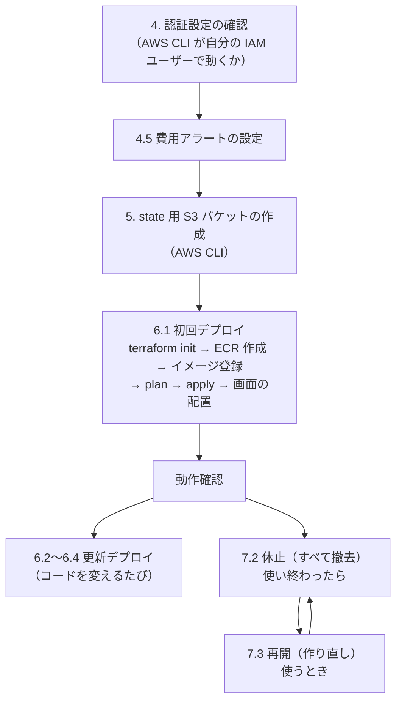

# タスク管理アプリ AWS デプロイ手順書

## 1. 文書情報

| 項目 | 内容 |
| --- | --- |
| 文書名 | タスク管理アプリ AWS デプロイ手順書 |
| 版数 | 1.3 |
| 作成日 | 2026-10-11 |
| 最終更新日 | 2026-10-17 |
| 作成者 | KeiT0773 |
| ステータス | 初版（実際のデプロイ後に、詰まった点を反映して改訂する） |
| 上位文書 | [インフラ設計書](infra-design.md) |
| 関連文書 | [技術スタック](tech-stack.md)、[開発フロー](development-workflow.md) |

本書は、[インフラ設計書](infra-design.md) で定めた AWS の構成を、**AWS CLI と Terraform を使ってコマンドラインから** 構築・更新・休止・再開する手順をまとめたものである。AWS のマネジメントコンソール（ブラウザの管理画面）での操作は、最初のアカウント設定を除いて行わない。

AWS・Terraform・IaC に初めて触れる前提で、各手順の前に「何をしているのか」を解説する。手順だけを知りたいときは 10. の早見表を見る。

### 1.1 変更履歴

| 版数 | 日付 | 変更内容 | 変更者 |
| --- | --- | --- | --- |
| 1.0 | 2026-10-11 | 初版作成。IaC・Terraform・AWS の基礎解説、AWS CLI の認証設定、state の置き場の準備、デプロイ・停止・撤去・トラブルシューティングの手順を記載 | KeiT0773 |
| 1.1 | 2026-10-11 | 使わない期間はすべてのリソースを `terraform destroy` で撤去する運用（[インフラ設計書](infra-design.md) 1.1）に合わせ、7. を「費用・休止・再開」に書き直した（スナップショットによるデータの引き継ぎ、休止・再開のスクリプト、利用をやめるときの片付け）。4.5 の予算を $20 に変更。6.1 の変数、8.、9.、10. を対応させて更新 | KeiT0773 |
| 1.2 | 2026-10-17 | 要件定義書 7.「費用」の追加（リソースを無料利用枠と同じ規模に制限）に合わせ、2.3.4 に Fargate Spot と SSM パラメータストアを追加して Secrets Manager を削除。7.1 の費用（約 $0.07 / 時間）、8.、9.1 を更新し、9.5 から Secrets Manager の削除予定のエラーを除外 | KeiT0773 |
| 1.3 | 2026-10-17 | Terraform のコードとスクリプトの作成に合わせて更新。1.2 にスクリプトの確認と `--yes` を追記。6.1 (4) の ECR のアドレスを AWS CLI で読む形に修正し、(5) の件数を実際の値（43 件）に。7.2・7.3 の手順を実装の順序に合わせ、8. にスキルと `permissions.ask` を明記。9.1 に暗号化しない接続のエラーを追加 | KeiT0773 |

### 1.2 本書のコマンドについて

- コマンドはすべて **Git Bash** 向けに書いている（Cursor のターミナルパネルで Git Bash を使う前提）。PowerShell ではそのまま動かない。
- 先頭が `$` の行はコマンドの入力例、そうでない行は出力例である。`$` 自体は入力しない。
- `<...>` の部分は自分の値に置き換える。
- `infra/scripts/` のスクリプトは、AWS の実物を変える前に必ず確認（`[y/N]`）を求める。確認済みの内容をもう一度実行するときは `--yes` を付けると確認を省略できる。端末から入力できない環境（Claude など）で `--yes` なしに実行すると、確認の手前で止まる（8.）。

> **Git Bash の注意（パスの自動変換）**
> Git Bash は、`/` で始まる引数を Windows のパス（`C:/Program Files/Git/...`）に書き換えてしまう。CloudFront のパス指定（`"/*"`）や CloudWatch Logs のロググループ名（`/ecs/...`）を渡すときは、コマンドの先頭に `MSYS_NO_PATHCONV=1` を付けて、この書き換えを止める。本書では必要な箇所に付けてある。

### 1.3 進め方と本書の対応

デプロイは次の 4 段階に分けて、1 段階ずつ Issue と PR を作って進める（[開発フロー](development-workflow.md)）。本書は段階 1 で作成し、段階 2・3 で作るファイルを前提に手順を書いている。

| 段階 | 内容 | 本書の該当箇所 |
| --- | --- | --- |
| 1 | 設計書と本書の作成 | — |
| 2 | バックエンドの本番向け準備（`Dockerfile`、`application-prod.properties`、サンプルデータの分離） | 6.1 の前提 |
| 3 | Terraform のコード（`infra/terraform/`）とデプロイ用スクリプト（`infra/scripts/`） | 5.〜7. |
| 4 | 実際に AWS 上に構築し、動作を確認する | 4.〜6. |

---

## 2. 基礎知識

### 2.1 IaC（Infrastructure as Code）とは

**インフラ（サーバー、ネットワーク、データベースなど）の構成を、コードとして書いて管理する考え方** である。

マネジメントコンソールでボタンを押して作る方法（手作業）と比べると、次の違いがある。

| 観点 | 手作業（コンソール） | IaC（Terraform） |
| --- | --- | --- |
| 再現性 | 同じ環境をもう一度作るには、同じ操作を記憶か手順書で再現する。押し忘れが起きやすい | コードを実行すれば、いつでも同じ構成ができる |
| 変更の確認 | 何が変わるかは、押してみるまで分からない | 実行前に「何が作られ、何が変わり、何が消えるか」を一覧で確認できる（`terraform plan`） |
| 履歴 | 誰がいつ何を変えたか残りにくい | Git にコミットとして残る。PR でレビューできる |
| 撤去 | 作ったものを一つずつ探して消す。消し忘れると課金が続く | `terraform destroy` で、コードに書いたものをまとめて消せる |
| AI との相性 | 画面操作は AI に任せにくい | コードとコマンドなので、AI が読み書き・実行できる |

本プロジェクトで「コンソールを使わず、AI にコマンドでデプロイさせる」ことができるのは、IaC にしているからである。

### 2.2 Terraform の仕組み

Terraform は HashiCorp 社が開発した IaC ツールで、**HCL**（HashiCorp Configuration Language）という言語で「あるべき構成」を書く。

#### 2.2.1 宣言的に書く

Terraform のコードには「こういう状態であってほしい」という **結果** を書く。「バケットを作れ」という **手順** は書かない。

```hcl
# 「taskmanagement-frontend という S3 バケットが存在する」という状態を宣言する
resource "aws_s3_bucket" "frontend" {
  bucket = "taskmanagement-frontend-123456789012"
}
```

Terraform は、今の AWS の状態とコードを比べて、差を埋めるのに必要な操作（作成・変更・削除）を自分で考えて実行する。同じコードを 2 回実行しても、2 つ目のバケットは作られない（既にあるので差が無い）。

#### 2.2.2 主な用語

| 用語 | 意味 | 例 |
| --- | --- | --- |
| プロバイダー（provider） | Terraform が操作する相手（AWS、GitHub など）ごとのプラグイン。`terraform init` でダウンロードされる | `hashicorp/aws` |
| リソース（resource） | Terraform が作って管理するもの 1 つ | `resource "aws_db_instance" "main" { ... }` |
| データソース（data） | Terraform が作らず、既にあるものの情報を読むだけのもの | `data "aws_caller_identity" "current" {}`（自分のアカウント ID を読む） |
| 変数（variable） | 外から渡す入力値。環境ごとに変わる値やイメージのタグなど | `variable "backend_image_tag" {}` |
| 出力（output） | 実行後に表示・取得したい値 | CloudFront の URL、ECR のアドレス |
| state（ステート） | Terraform が「自分が作ったもの」を記録したファイル（`terraform.tfstate`）。2.2.3 で説明 | — |
| モジュール（module） | 複数のリソースをまとめて部品にしたもの。本プロジェクトでは使わない | — |

リソース同士は、互いの属性を参照してつなぐ。

```hcl
resource "aws_db_instance" "main" {
  # 別のリソース（パスワード）の値を参照する
  password = random_password.db.result
}
```

参照があると、Terraform は「パスワードを先に作り、次に DB を作る」という順序を自動で決める。

#### 2.2.3 state（ステート）

state は、**コードに書いたリソースが、AWS 上の実物のどれに当たるか** を記録した JSON ファイルである。

- Terraform は「コード」「state」「AWS の実物」の 3 つを突き合わせて、何をすべきかを判断する。
- state を失うと、Terraform は自分が作ったものを把握できなくなる（同じものをもう一つ作ろうとしたり、消せなくなったりする）。
- state にはリソースの属性が丸ごと記録されるため、**DB のパスワードのような秘密情報も平文で入る**（[インフラ設計書](infra-design.md) 9.1）。

このため state は手元の PC ではなく、**S3 バケットに置く**（リモートステート）。PC が壊れても失われず、暗号化とアクセス制限ができ、バージョニングで過去の state に戻せる。

同時に 2 か所から `terraform apply` すると state が壊れるため、実行中は **ロック** をかける。Terraform 1.10 以降は、S3 上にロック用のファイル（`.tflock`）を置くだけでロックできる（`use_lockfile = true`）。

#### 2.2.4 基本のコマンドと流れ

```
コードを書く → init → fmt → validate → plan → apply →（不要になったら）destroy
```

| コマンド | すること | いつ使うか |
| --- | --- | --- |
| `terraform init` | プロバイダーのダウンロード、state の保存先（S3）への接続 | 最初の 1 回。プロバイダーや保存先の設定を変えたとき |
| `terraform fmt` | コードの書式を整える | コードを書いたあと（`-check` で確認だけもできる） |
| `terraform validate` | 文法と、参照の整合性を確認する（AWS には問い合わせない） | コードを書いたあと |
| `terraform plan` | AWS の現状と比べて、何をするかの計画を表示する。**何も変更しない** | apply の前に必ず |
| `terraform apply` | 計画を実行して、AWS 上のリソースを作る・変える・消す | 計画を確認したあと |
| `terraform output` | 出力値を表示する | URL などを確認したいとき |
| `terraform destroy` | state に記録されたリソースをすべて消す | 環境を撤去するとき |

本書では、リポジトリのルートから `terraform -chdir=infra/terraform <コマンド>` の形で実行する。`-chdir` は「このフォルダーに移動してから実行する」という指定で、`cd infra/terraform` してから実行するのと同じである。

#### 2.2.5 plan の読み方

`terraform plan` は、リソースごとに記号を付けて計画を表示する。

| 記号 | 意味 | 注意 |
| --- | --- | --- |
| `+` | 新しく作る | — |
| `~` | その場で設定を変える（作り直さない） | — |
| `-` | 消す | 意図した削除か必ず確認する |
| `-/+` | いったん消して作り直す | **特に注意。** RDS が `-/+` になっているとデータが消える。`# forces replacement` と書かれた項目が作り直しの原因 |

最後に `Plan: 3 to add, 1 to change, 0 to destroy.` のような集計が出る。`destroy` が 0 でないときは、何が消えるのかを必ず確認する。

#### 2.2.6 コンソールで変更してはいけない理由

Terraform で作ったリソースをコンソールで手作業で変えると、コードと実物が食い違う（これを **ドリフト** という）。次の `terraform apply` で、Terraform はコードのとおりに戻そうとするため、手作業の変更は消える。変更は必ずコードを直して `apply` する。

### 2.3 AWS の基礎

#### 2.3.1 アカウントと IAM

| 用語 | 意味 |
| --- | --- |
| AWS アカウント | 課金とリソースの単位。12 桁のアカウント ID で識別する |
| ルートユーザー | アカウント作成時のメールアドレスでログインする、何でもできる特別なユーザー。**日常の作業には使わない**。MFA（多要素認証）を必ず設定する |
| IAM ユーザー | アカウントの中に作る、人が使うためのユーザー。付けたポリシーの範囲でだけ操作できる |
| IAM グループ | IAM ユーザーをまとめる入れ物。グループに付けたポリシーは、所属するユーザー全員に効く |
| IAM ポリシー | 「どの操作を、どのリソースに対して許可するか」を書いた JSON。`AdministratorAccess` は全操作を許可する AWS 管理ポリシー |
| IAM ロール | 人ではなく、AWS のサービス（ECS など）が一時的に名乗る身分。パスワードやアクセスキーを持たない |
| アクセスキー | IAM ユーザーがコマンドラインやプログラムから AWS を操作するための、ID とシークレットの組。**パスワードと同じ重さで扱う** |

#### 2.3.2 リージョンとアベイラビリティゾーン

- **リージョン**：AWS のデータセンター群がある地域。本プロジェクトは東京（`ap-northeast-1`）を使う。リソースは原則としてリージョンごとに独立しており、コマンドで別のリージョンを指定すると「何も無い」ように見える。
- **アベイラビリティゾーン（AZ）**：リージョンの中の、独立したデータセンターのまとまり。東京なら `ap-northeast-1a`、`1c`、`1d`。ALB や RDS は、障害に備えて 2 つ以上の AZ のサブネットを指定する決まりになっている。

#### 2.3.3 ネットワーク（VPC）

| 用語 | 意味 | 家に例えると |
| --- | --- | --- |
| VPC | AWS の中に作る、自分専用の閉じたネットワーク。IP アドレスの範囲（例：`10.0.0.0/16`）を決めて作る | 敷地 |
| サブネット | VPC をさらに区切った範囲。1 つの AZ に属する | 部屋 |
| インターネットゲートウェイ（IGW） | VPC とインターネットをつなぐ出入口 | 玄関 |
| ルートテーブル | サブネットから出る通信を、どこへ送るかの規則 | 廊下の案内板 |
| パブリックサブネット | ルートテーブルに「インターネット宛ては IGW へ」がある部屋。パブリック IP を持つリソースは外と通信できる | 玄関につながる部屋 |
| プライベートサブネット | IGW への経路が無い部屋。インターネットとは直接通信できない | 奥の部屋 |
| セキュリティグループ | リソースごとの仮想ファイアウォール。「どこから、どのポートへの通信を受け付けるか」を許可リストで書く | 部屋の扉の鍵（誰を入れるかのリスト） |
| NAT Gateway | プライベートサブネットから外へ出るための中継器。月 $45 程度かかるため本構成では使わない | 奥の部屋専用の勝手口 |

#### 2.3.4 今回使うサービス

| サービス | 一言でいうと | 本構成での役割 |
| --- | --- | --- |
| S3 | ファイル置き場（オブジェクトストレージ） | 画面の HTML・JS・CSS を置く。Terraform の state も置く |
| CloudFront | 世界中に配置されたキャッシュサーバー網（CDN）。HTTPS の入口 | 利用者からの要求をすべて受け、画面は S3 から、`/api/*` は ALB から取ってくる |
| OAC | CloudFront だけが S3 を読めるようにする仕組み | S3 を一般公開せずに画面を配信する |
| VPC オリジン | CloudFront から、VPC の中（外部非公開）のリソースへ直接つなぐ仕組み | 内部 ALB を外に出さずに API を配信する |
| ALB | HTTP の要求を、後ろのサーバー群に振り分ける装置（ロードバランサー） | CloudFront から受けた API の要求を ECS タスクへ渡し、タスクの死活を監視する |
| ECR | Docker イメージの置き場（Docker Hub の AWS 版） | Spring Boot のイメージを置く |
| ECS | コンテナを動かし続ける仕組み。「このイメージを常に 1 つ動かしておく」と指示すると、落ちても立て直す | Spring Boot のコンテナを動かす |
| Fargate | ECS の起動方式の一つ。サーバー（EC2）を用意せず、コンテナだけを AWS に動かしてもらう | OS のパッチ当てなどの管理を不要にする |
| Fargate Spot | Fargate のうち、AWS の空き容量を使う割安な方式（通常の約 3 割の料金）。空き容量が足りなくなると、2 分前の通知のあと中断されることがある | 費用を抑える（[インフラ設計書](infra-design.md) 2.1）。中断されても ECS が自動で起動し直す |
| RDS | 管理付きのデータベース。インストール・パッチ・バックアップを AWS が行う | PostgreSQL を動かす |
| SSM パラメータストア | 設定値や秘密情報を保管する場所。標準の範囲は無料で、`SecureString` を選ぶと暗号化して保管する | DB パスワードを保管し、ECS タスクに渡す。有料の Secrets Manager の代わりに使う |
| CloudWatch Logs | ログの保管・閲覧 | Spring Boot のログを見る |
| AWS Budgets | 費用の予算管理と通知 | 使いすぎをメールで知らせる |

ECS には次の 3 つの階層がある。

| 用語 | 意味 |
| --- | --- |
| クラスター | タスクを動かす場所のまとまり（論理的な入れ物） |
| タスク定義 | 「どのイメージを、どれだけの CPU・メモリ・環境変数で動かすか」の設計図。変更するたびにリビジョン（版）が増える |
| サービス | 「このタスク定義のタスクを、常に N 個動かしておく」という指示。タスク定義の新しいリビジョンを指定すると、古いタスクを新しいタスクに入れ替える |

---

## 3. 全体の流れと事前準備

### 3.1 全体の流れ



### 3.2 必要なツール

| ツール | 確認コマンド | 確認済みのバージョン（2026-10-11） | 用途 |
| --- | --- | --- | --- |
| AWS CLI v2 | `aws --version` | 2.31.38 | AWS をコマンドで操作する |
| Terraform | `terraform -version` | 1.13.5（1.10 以上が必要） | インフラを構築する |
| Docker Desktop | `docker --version` | 29.8.0 | バックエンドのイメージを作る。**起動しておく** |
| Node.js / npm | `node --version` | 24 系 | 画面をビルドする |
| Git Bash | — | — | 本書のコマンドを実行する |

Terraform は最新版（2026-10 時点で 1.16 系）でなくても動く。上げる場合は https://developer.hashicorp.com/terraform/install から Windows 用の zip を取得し、今の `terraform.exe`（`which terraform` で場所を確認）を置き換える。

---

## 4. AWS アカウントとの認証設定

### 4.1 仕組み：AWS CLI と Terraform は「誰として」AWS を操作するのか

AWS を操作するコマンドは、すべて **IAM ユーザーのアクセスキー** で署名して送られる。AWS はその署名から「誰の操作か」を判断し、その人のポリシーで許可されているかを確かめる。

アクセスキーは、`aws configure` コマンドで入力すると、次の 2 つのファイルに保存される。

| ファイル | 中身 | 例 |
| --- | --- | --- |
| `~/.aws/credentials` | アクセスキー ID とシークレットアクセスキー（**秘密**） | `aws_access_key_id = AKIA...` |
| `~/.aws/config` | リージョンと出力形式（秘密ではない） | `region = ap-northeast-1` |

`~` は自分のホームフォルダー（`C:\Users\<ユーザー名>`）を指す。ファイルの中は `[default]` のような **プロファイル**（設定のまとまり）ごとに分かれている。名前を付けずに `aws configure` すると `default` に保存される。

AWS CLI も Terraform（AWS プロバイダー）も、同じ 2 つのファイルを読む。どの認証情報を使うかは、次の優先順で決まる。

| 優先順 | 置き場所 | 本プロジェクトでの扱い |
| --- | --- | --- |
| 1 | 環境変数 `AWS_ACCESS_KEY_ID` / `AWS_SECRET_ACCESS_KEY` | 使わない（設定されていると、こちらが優先されて混乱のもとになる） |
| 2 | 環境変数 `AWS_PROFILE` で指定したプロファイル | 使わない |
| 3 | `default` プロファイル | **これを使う** |

つまり、`default` プロファイルが正しく設定されていれば、AWS CLI も Terraform も追加の指定なしで同じ IAM ユーザーとして動く。

### 4.2 登録済みの設定を確認する

既に `aws configure` を済ませている場合は、次の 3 つを確認すれば十分である。

**(1) どの設定が使われているか**

```bash
$ aws configure list
NAME       : VALUE                    : TYPE             : LOCATION
profile    : <not set>                : None             : None
access_key : ****************KQJT     : shared-credentials-file :
secret_key : ****************M7k3     : shared-credentials-file :
region     : ap-northeast-1           : config-file      : ~/.aws/config
```

`TYPE` が `shared-credentials-file` なら `~/.aws/credentials` から読んでいる。`env` と出たら環境変数が優先されているので、意図したものか確認する。`region` が `ap-northeast-1` であることも確認する。

**(2) 誰として操作しているか**

```bash
$ aws sts get-caller-identity
{
    "UserId": "AIDA...",
    "Account": "512795167785",
    "Arn": "arn:aws:iam::512795167785:user/taka-admin"
}
```

`sts get-caller-identity` は、権限が無くても必ず実行できる「自分は誰か」を返すコマンドである。

- `Arn` が `...:user/<名前>` なら IAM ユーザー。これで正しい。
- `Arn` が `...:root` なら **ルートユーザーのアクセスキー** である。ルートのキーは何でもできてしまい、漏れたときの被害が最大になるため、**使用を中止** し、4.3 の手順で IAM ユーザーを作り直す。その後、ルートのキーは削除する。
- `InvalidClientTokenId` や `SignatureDoesNotMatch` が出たら、キーが無効（削除済み、または入力ミス）である。4.3 の手順 4 からやり直す。

**(3) 必要な権限があるか**

```bash
# ユーザーに直接付いているポリシー
$ aws iam list-attached-user-policies --user-name <IAM ユーザー名>

# 所属しているグループと、グループに付いているポリシー
$ aws iam list-groups-for-user --user-name <IAM ユーザー名>
$ aws iam list-attached-group-policies --group-name <グループ名>
```

本構成では VPC・ECS・RDS・IAM ロールなど多くの種類のリソースを作るため、`AdministratorAccess`（ユーザーに直接、またはグループ経由）が付いていることを確認する。

> **本プロジェクトの確認結果（2026-10-11）**
> `default` プロファイルは IAM ユーザー `taka-admin`（アカウント `512795167785`）のアクセスキーで、ルートではない。グループ `AdminGroup` 経由で `AdministratorAccess` を持ち、MFA も設定済み。アクセスキーは 1 本（2025-11-14 作成、有効）。このまま使う（[インフラ設計書](infra-design.md) 決定事項 No.9）。

### 4.3 ゼロから設定する場合

新しい PC で設定するときや、キーを作り直すときの手順。手順 1〜3 は、**アクセスキーをまだ持っていないので** ブラウザのコンソールで行う（コマンドで行うには、そもそも認証情報が必要なため）。

| 手順 | 作業 | 場所 |
| --- | --- | --- |
| 1 | ルートユーザーでサインインし、ルートユーザーに MFA を設定する | コンソール（右上のアカウント名 →「セキュリティ認証情報」） |
| 2 | IAM ユーザーを作る。グループ（例：`AdminGroup`）を作って `AdministratorAccess` を付け、ユーザーをそのグループに入れる | コンソール（IAM →「ユーザー」→「ユーザーの作成」） |
| 3 | IAM ユーザーで MFA を設定する | コンソール（IAM ユーザーでサインインし直して設定） |
| 4 | IAM ユーザーのアクセスキーを発行する。用途は「コマンドラインインターフェイス（CLI）」を選ぶ。**シークレットアクセスキーはこの画面でしか表示されない** | コンソール（IAM → ユーザー →「セキュリティ認証情報」→「アクセスキーを作成」） |
| 5 | `aws configure` でキーを登録する | Git Bash |
| 6 | 4.2 の (1)〜(3) で確認する | Git Bash |

手順 5 は次のように対話形式で入力する。

```bash
$ aws configure
AWS Access Key ID [None]: AKIA................
AWS Secret Access Key [None]: ........................................
Default region name [None]: ap-northeast-1
Default output format [None]: json
```

> **なぜ AdministratorAccess なのか（最小権限の考え方）**
> 本来、IAM ユーザーには「必要な操作だけ」を許可するのが原則（最小権限）である。ただし Terraform で多種類のサービスを作る場合、必要な権限を事前に洗い出すのは難しく、学習の妨げになる。本プロジェクトは個人の学習用アカウントのため `AdministratorAccess` を使い、代わりに MFA・キーの管理（4.4）・費用アラート（4.5）で安全を補う。

### 4.4 アクセスキーを安全に扱う

| ルール | 理由 |
| --- | --- |
| キーをリポジトリのファイル、チャット、AI への入力、スクリーンショットに含めない | 公開リポジトリに載ったキーは数分以内に悪用されることがある。不正利用で高額な請求が来た事例が多い |
| `~/.aws/credentials` の中身を表示するコマンド（`cat` など）を AI に実行させない | AI との会話の記録にキーが残る |
| キーは 1 ユーザーにつき 1 本だけ有効にする | どこで使われているキーか分からなくなるのを防ぐ |
| 定期的に（例：90 日ごと）作り直す（ローテーション） | 気づかないうちに漏れていた場合の被害期間を短くする |

**ローテーションの手順**（新しいキーを作り、動作を確かめてから古いキーを消す）

```bash
# 1. 今のキーの ID を確認する
$ aws iam list-access-keys --user-name <IAM ユーザー名>

# 2. 新しいキーを作る（出力の AccessKeyId と SecretAccessKey を控える。表示はこの 1 回だけ）
$ aws iam create-access-key --user-name <IAM ユーザー名>

# 3. 新しいキーを登録する（対話形式で新しい値を入力。リージョン・出力形式は Enter で据え置き）
$ aws configure

# 4. 新しいキーで動くことを確認する
$ aws sts get-caller-identity

# 5. 古いキーを無効にし、問題が無ければ削除する
$ aws iam update-access-key --user-name <IAM ユーザー名> --access-key-id <古いキーの ID> --status Inactive
$ aws iam delete-access-key --user-name <IAM ユーザー名> --access-key-id <古いキーの ID>
```

**漏れたかもしれないとき** は、まず `update-access-key ... --status Inactive` でキーを止め、ローテーションの手順で作り直す。そのうえで 7.5 の手順で、見覚えのないリソースが作られていないか費用の内訳を確認する。

### 4.5 費用アラートを設定する（AWS Budgets）

使いすぎに早く気づくため、**デプロイの前に** 月額予算と通知を設定する。予算は $20 とする（[インフラ設計書](infra-design.md) 11.3）。使わない期間は休止する（7.）前提なので、普段の費用は月数ドルに収まる。休止し忘れて数日つけっぱなしにすると $16（予算の 80%）を超え、メールが届く。

```bash
# 自分のアカウント ID を変数に入れる
$ ACCOUNT_ID=$(aws sts get-caller-identity --query Account --output text)

# 予算の定義（月額 20 ドル、実費ベース）
$ cat > budget.json <<'EOF'
{
  "BudgetName": "taskmanagement-monthly",
  "BudgetLimit": { "Amount": "20", "Unit": "USD" },
  "TimeUnit": "MONTHLY",
  "BudgetType": "COST"
}
EOF

# 通知の定義（実績が 80% を超えたとき、月末の予測が 100% を超えそうなとき）
$ cat > notifications.json <<'EOF'
[
  {
    "Notification": {
      "NotificationType": "ACTUAL",
      "ComparisonOperator": "GREATER_THAN",
      "Threshold": 80,
      "ThresholdType": "PERCENTAGE"
    },
    "Subscribers": [{ "SubscriptionType": "EMAIL", "Address": "<通知を受け取るメールアドレス>" }]
  },
  {
    "Notification": {
      "NotificationType": "FORECASTED",
      "ComparisonOperator": "GREATER_THAN",
      "Threshold": 100,
      "ThresholdType": "PERCENTAGE"
    },
    "Subscribers": [{ "SubscriptionType": "EMAIL", "Address": "<通知を受け取るメールアドレス>" }]
  }
]
EOF

# 予算を作る
$ aws budgets create-budget \
    --account-id "$ACCOUNT_ID" \
    --budget file://budget.json \
    --notifications-with-subscribers file://notifications.json

# 作られたことを確認し、一時ファイルを消す
$ aws budgets describe-budgets --account-id "$ACCOUNT_ID" --query 'Budgets[].BudgetName'
$ rm budget.json notifications.json
```

- `<<'EOF' ... EOF` は「ここから EOF までをファイルに書く」という Git Bash の書き方（ヒアドキュメント）である。
- Budgets は費用の集計に数時間〜1 日の遅れがある。即時に止まる仕組みではなく、あくまで通知である。

### 4.6 参考：IAM Identity Center（一時的な認証情報）

本プロジェクトは長期のアクセスキー（明示的に消すまで有効）を使うが、AWS がより推奨しているのは **IAM Identity Center** による一時的な認証情報である。`aws sso login` でブラウザ認証し、数時間で自動的に無効になる認証情報を使うため、キーが漏れても被害が限られる。

```bash
$ aws configure sso                    # 最初の 1 回だけ。Identity Center の URL などを登録する
$ aws sso login --profile <プロファイル名>   # 作業のたびにブラウザで認証する
$ export AWS_PROFILE=<プロファイル名>       # Terraform にもこのプロファイルを使わせる
```

Identity Center の有効化とユーザー作成が別途必要になるため、本版では採用しない（[インフラ設計書](infra-design.md) 14.）。

---

## 5. Terraform の state 置き場を作る

2.2.3 で説明した state を保存する S3 バケットを、**AWS CLI で** 作る。Terraform で作らないのは、「state を置く場所」を Terraform で管理すると、その state をどこに置くかという循環が起きるためである。この作業は最初の 1 回だけ行う。

```bash
# バケット名を決める（S3 のバケット名は世界で一意なので、アカウント ID を付ける）
$ ACCOUNT_ID=$(aws sts get-caller-identity --query Account --output text)
$ STATE_BUCKET="taskmanagement-tfstate-${ACCOUNT_ID}"
$ echo "$STATE_BUCKET"

# 1. バケットを作る（東京リージョンを明示する）
$ aws s3api create-bucket \
    --bucket "$STATE_BUCKET" \
    --region ap-northeast-1 \
    --create-bucket-configuration LocationConstraint=ap-northeast-1

# 2. バージョニングを有効にする（state を壊しても過去の版に戻せる）
$ aws s3api put-bucket-versioning \
    --bucket "$STATE_BUCKET" \
    --versioning-configuration Status=Enabled

# 3. 保存時の暗号化を有効にする（state には DB パスワードが入るため）
$ aws s3api put-bucket-encryption \
    --bucket "$STATE_BUCKET" \
    --server-side-encryption-configuration '{"Rules":[{"ApplyServerSideEncryptionByDefault":{"SSEAlgorithm":"AES256"}}]}'

# 4. パブリックアクセスをすべて禁止する
$ aws s3api put-public-access-block \
    --bucket "$STATE_BUCKET" \
    --public-access-block-configuration BlockPublicAcls=true,IgnorePublicAcls=true,BlockPublicPolicy=true,RestrictPublicBuckets=true

# 確認
$ aws s3api get-bucket-versioning --bucket "$STATE_BUCKET"
$ aws s3api get-public-access-block --bucket "$STATE_BUCKET"
```

新しく作る S3 バケットは、現在の AWS では既定で暗号化とパブリックアクセス禁止が有効になっている。2.・3. は既定の設定と同じだが、意図を明示するために実行する。

---

## 6. デプロイ

### 6.1 初回デプロイ

ここでは仕組みを理解するため、1 段ずつ手で実行する。同じことは 7.3 の `startup.sh` で一括しても行える（初回でも使える）。2 回目以降（休止からの再開）は `startup.sh` を使う。

#### 前提

- 段階 2・3 の PR がマージされ、`main` を手元に取り込んでいる（`git switch main && git pull --ff-only`）
- Docker Desktop が起動している
- 4.・5. が済んでいる

#### (1) Terraform の入力値を用意する

```bash
$ cp infra/terraform/terraform.tfvars.example infra/terraform/terraform.tfvars
```

`terraform.tfvars` は Terraform の変数に渡す値を書くファイルで、`terraform plan` / `apply` のときに自動で読まれる。Git には含めない（`.gitignore` 済み）。主な値は次のとおり。

| 変数 | 意味 | 初回の値 |
| --- | --- | --- |
| `backend_image_tag` | ECS で動かすイメージのタグ（Git のコミットハッシュ） | (4) で決まる |
| `db_snapshot_identifier` | DB を復元するスナップショットの名前。空なら DB を新規に作る | `""`（空） |

#### (2) terraform init（state の保存先に接続する）

```bash
$ terraform -chdir=infra/terraform init -backend-config="bucket=${STATE_BUCKET}"
```

- AWS プロバイダーがダウンロードされ、`infra/terraform/.terraform/` に置かれる。
- state の保存先として、5. で作ったバケットが登録される。バケット名はアカウントごとに違うため、コードに直接書かず `-backend-config` で渡す。
- `Terraform has been successfully initialized!` と出れば成功。

#### (3) ECR だけ先に作る

ECS はイメージが ECR に無いと起動できず、イメージを ECR に登録するには ECR が先に必要である。この順序の問題を解くため、最初だけ ECR を単独で作る。

```bash
$ terraform -chdir=infra/terraform apply -target=aws_ecr_repository.backend
```

`-target` は「指定したリソース（と、それが依存するもの）だけを対象にする」という指定である。普段は使わない（全体の整合が崩れるため）。計画が表示されたら、`aws_ecr_repository.backend` が `+`（作成）の 1 件だけであることを確認して `yes` を入力する。

#### (4) バックエンドのイメージを作って ECR に登録する

```bash
# イメージのタグ = 今のコミットの短縮ハッシュ
$ TAG=$(git rev-parse --short HEAD)
$ ECR_URL=$(aws ecr describe-repositories --repository-names taskmanagement-backend \
    --query 'repositories[0].repositoryUri' --output text)

# ECR にログインする（Docker に、ECR へのアップロード用の一時パスワードを渡す）
$ aws ecr get-login-password --region ap-northeast-1 \
    | docker login --username AWS --password-stdin "${ECR_URL%%/*}"

# イメージを作る（backend/Dockerfile を使う）
$ docker build -t "${ECR_URL}:${TAG}" backend

# ECR に登録する
$ docker push "${ECR_URL}:${TAG}"
```

- ECR のアドレスは `terraform output` ではなく AWS CLI で読む。(3) で ECR だけを先に作った直後は、ほかのリソースがまだ無いため、`terraform output` に値が入らないことがあるためである。
- `${ECR_URL%%/*}` は「`ECR_URL` の最初の `/` より前」を取り出す Bash の書き方で、レジストリのホスト名（`<アカウント ID>.dkr.ecr.ap-northeast-1.amazonaws.com`）になる。
- `infra/terraform/terraform.tfvars` の `backend_image_tag` に、`$TAG` の値（`echo "$TAG"` で表示）を書く。

#### (5) plan で計画を確認する

```bash
$ terraform -chdir=infra/terraform plan -out=tfplan
```

`-out=tfplan` は計画をファイルに保存する指定で、次の `apply` で **確認した計画と全く同じ内容** を実行できる。初回は `Plan: 43 to add, 0 to change, 0 to destroy.`（ECR を (3) で作った後なので 41 前後）になる。`to change` と `to destroy` は 0 のはずである。

#### (6) apply で構築する

```bash
$ terraform -chdir=infra/terraform apply tfplan
```

保存した計画を渡したときは `yes` の確認は出ない（(5) で確認済みのため）。RDS と CloudFront の作成に時間がかかり、全体で 15〜20 分程度かかる。

完了すると出力値が表示される。あとから見るときは次のコマンドを使う。

```bash
$ terraform -chdir=infra/terraform output
```

#### (7) ECS のタスクが起動するのを待つ

```bash
$ CLUSTER=$(terraform -chdir=infra/terraform output -raw ecs_cluster_name)
$ SERVICE=$(terraform -chdir=infra/terraform output -raw ecs_service_name)
$ aws ecs wait services-stable --cluster "$CLUSTER" --services "$SERVICE"
```

`wait` は、状態が安定するまで待ってから終わるコマンドである（最長 10 分）。何も表示されずに終われば、タスクが起動して ALB のヘルスチェックに合格している。エラーで終わったら 9.1 を見る。

#### (8) 画面を配置する

```bash
$ bash infra/scripts/deploy-frontend.sh
```

スクリプトは次の 3 つを行う（6.3 と同じ）。

1. `frontend` で `npm ci` と `npm run build` を実行し、`frontend/dist` を作る
2. `aws s3 sync` で `frontend/dist` の中身を画面用の S3 バケットにアップロードする（`--delete` で、`dist` に無い古いファイルを消す）
3. `aws cloudfront create-invalidation` で CloudFront のキャッシュを無効にする

#### (9) 動作を確認する

```bash
$ APP_URL=$(terraform -chdir=infra/terraform output -raw app_url)
$ echo "$APP_URL"
$ curl -i "${APP_URL}/api/health"
$ curl -i "${APP_URL}/api/health/db"
$ curl -i "${APP_URL}/api/cards"
```

| 確認 | 期待する結果 |
| --- | --- |
| `/api/health` | `200`、`{"status":"ok"}` |
| `/api/health/db` | `200`、`{"status":"ok","database":"PostgreSQL 16..."}` |
| `/api/cards` | `200`、`[]`（本番にはサンプルカードを入れないため、空） |
| ブラウザで `APP_URL` を開く | 空のボードが表示され、カードの登録・編集・移動・並べ替え・削除ができる。再読み込みしてもデータが残る |
| `http://` で開く | `https://` に転送される |

### 6.2 バックエンドを更新する

バックエンドのコードを変えた PR をマージしたあとに行う。

```bash
$ git switch main && git pull --ff-only
$ bash infra/scripts/deploy-backend.sh
```

スクリプトは次を行う。

1. コミットハッシュをタグにしてイメージを作り、ECR に登録する（6.1 (4) と同じ）
2. `terraform.tfvars` の `backend_image_tag` を新しいタグに書き換える
3. `terraform plan` を表示し、確認のうえ `terraform apply` する。タスク定義の新しいリビジョンが作られ、ECS サービスが古いタスクを新しいタスクに入れ替える（ローリング更新）
4. `aws ecs wait services-stable` で入れ替えが終わるのを待つ

plan では `aws_ecs_task_definition.backend` が `-/+`（作り直し）、`aws_ecs_service.backend` が `~`（変更）になる。タスク定義は変更のたびに新しいリビジョンを作る仕様のため、この `-/+` は正常である。**RDS が `-/+` になっていたら中止する。**

Flyway のマイグレーション（`V4__...sql` など）を追加した場合は、新しいタスクの起動時に自動で適用される。

### 6.3 画面を更新する

フロントエンドのコードを変えた PR をマージしたあとに行う。

```bash
$ git switch main && git pull --ff-only
$ bash infra/scripts/deploy-frontend.sh
```

スクリプトの中で行う、キャッシュ無効化のコマンドは次のとおり（Git Bash のパス変換を止めるため `MSYS_NO_PATHCONV=1` を付ける）。

```bash
$ DIST_ID=$(terraform -chdir=infra/terraform output -raw cloudfront_distribution_id)
$ MSYS_NO_PATHCONV=1 aws cloudfront create-invalidation --distribution-id "$DIST_ID" --paths "/*"
```

無効化が全拠点に行き渡るまで 1〜2 分かかる。ブラウザに古い画面が残る場合は、強制再読み込み（`Ctrl + Shift + R`）する。

### 6.4 インフラの構成を変更する

`infra/terraform/` のコードを変えるときも、Issue → ブランチ → PR の流れで進める（[開発フロー](development-workflow.md)、種別は `chore`）。

```bash
# 書式と文法の確認（PR を作る前に）
$ terraform -chdir=infra/terraform fmt -check
$ terraform -chdir=infra/terraform validate

# 計画を確認する（ブランチ上で実行してよい。何も変更しない）
$ terraform -chdir=infra/terraform plan
```

`apply` は **PR をマージして `main` に取り込んだあと** に行う。ブランチ上のコードで `apply` すると、AWS の実物が `main` のコードより先に進んでしまい、他のブランチで `plan` したときに意図しない差分が出る。

---

## 7. 費用・休止・再開

本プロジェクトでは、**使わない期間はすべてのリソースを撤去して（休止）、使うときに作り直す（再開）**（[インフラ設計書](infra-design.md) 2. 方針 8）。IaC で構成をすべてコードにしてあるので、何度消しても同じ環境を作り直せる。

### 7.1 費用の目安

| 状態 | 費用の目安 | 内訳 |
| --- | --- | --- |
| 稼働中 | **約 $0.07 / 時間**（30 日つけっぱなしなら約 $50〜55） | RDS、ALB、Fargate Spot、パブリック IPv4 など。動いている時間に比例する。各リソースは無料利用枠と同じ規模に制限している（[インフラ設計書](infra-design.md) 2.1）が、このアカウントは無料利用枠の期間を過ぎているため課金される |
| 休止中 | **ほぼ $0**（月数セント） | DB のスナップショット（最新 2 つ）と、state 用バケット（数 KB）だけが残る |

例えば 1 日 3 時間 × 月 20 日の利用なら、月 $4 前後になる。**使い終わったら必ず休止する。** 休止し忘れたときは、4.5 の予算アラート（$20）で気づける。詳細は [インフラ設計書](infra-design.md) 11.。

### 7.2 休止する

```bash
$ bash infra/scripts/shutdown.sh
```

スクリプトは次の順に処理する（15〜25 分）。CloudFront の削除に最も時間がかかる。

1. `terraform plan -destroy` で撤去するものの件数を表示し、確認を求める（`y` で続行）
2. RDS のスナップショットを日時入りの名前で取り、完成を待つ（完成しなければ何も消さずに中止する）
3. 最新の 2 つより古いスナップショットを消す
4. 1. で確認した計画のとおりに撤去する
5. Terraform が管理するものが何も残っていないことを確認する

中で実行しているコマンドは次のとおり。スクリプトが途中で止まったときは、これを 1 つずつ実行すればよい。

```bash
# 1. スナップショットを取る（名前の例：taskmanagement-20261011-2130）
$ SNAPSHOT_ID="taskmanagement-$(date +%Y%m%d-%H%M)"
$ aws rds create-db-snapshot \
    --db-instance-identifier taskmanagement \
    --db-snapshot-identifier "$SNAPSHOT_ID"
$ aws rds wait db-snapshot-available --db-snapshot-identifier "$SNAPSHOT_ID"

# 2. 手動スナップショットを古い順に表示し、最新の 2 つ以外を消す
$ aws rds describe-db-snapshots \
    --db-instance-identifier taskmanagement \
    --snapshot-type manual \
    --query 'sort_by(DBSnapshots, &SnapshotCreateTime)[].DBSnapshotIdentifier' \
    --output text
$ aws rds delete-db-snapshot --db-snapshot-identifier <古いスナップショットの名前>

# 3. すべて撤去する
$ terraform -chdir=infra/terraform destroy

# 4. 何も残っていないことを確認する（何も表示されなければよい）
$ terraform -chdir=infra/terraform state list
```

- **スナップショットが完成する前に `destroy` してはいけない。** 登録したカードが失われる。手順 1 の `wait` が正常に終わったことを必ず確認する。
- `terraform state list` は「Terraform が管理しているリソースの一覧」を表示する。空なら、Terraform が作ったものはすべて消えている。
- 休止中に画面の URL を開いても、CloudFront 自体が無いのでつながらない。
- 休止しても消えないもの：DB のスナップショット、state 用バケット（5.）、予算アラート（4.5）。どれも Terraform の外で作ったか、Terraform の削除の対象外である。

### 7.3 再開する

```bash
$ bash infra/scripts/startup.sh
```

スクリプトは、6.1 の (3)〜(9) と同じことを一括で行う（20〜30 分）。

1. 最新のスナップショットを探し、`terraform.tfvars` の `db_snapshot_identifier` に書く（無ければ空にして、DB を新規に作る）
2. 作成されるリソースの件数を表示し、確認を求める（`y` で続行。ここから課金が始まる）
3. ECR だけを先に作る（6.1 (3)。休止で ECR とイメージも消えているため）
4. 今のコミットからイメージを作り、ECR に登録して、`backend_image_tag` を書き換える（6.1 (4)）
5. `terraform plan` → `terraform apply`。計画に削除・作り直しが含まれていたら中止する
6. ECS のタスクが起動するのを待つ（6.1 (7)）
7. 画面をビルドして配置する（6.1 (8)）
8. `/api/health/db` が 200 を返すことを確かめ、**新しい URL** を表示する

- **再開するたびに URL が変わる**（[インフラ設計書](infra-design.md) 3.2）。表示された URL をブラウザで開く。
- スナップショットから DB を復元するため、休止前に登録したカードがそのまま表示される。
- 前提：state 用バケット（5.）があり、Docker Desktop が起動していること。`terraform init`（6.1 (2)）が済んでいなければ、スクリプトが自動で行う。
- `backend/` にコミットしていない変更があると止まる。イメージのタグ（コミットハッシュ）と中身を一致させるためである。

### 7.4 アプリの利用をやめる（すべて片付ける）

今後このアプリを使わない場合は、休止したうえで、Terraform の外に残っているものも消す。**消したあとは、データも含めて元に戻せない。**

```bash
$ ACCOUNT_ID=$(aws sts get-caller-identity --query Account --output text)
$ STATE_BUCKET="taskmanagement-tfstate-${ACCOUNT_ID}"

# 1. 休止する（7.2。まだ休止していなければ）
$ bash infra/scripts/shutdown.sh

# 2. スナップショットをすべて消す
$ aws rds describe-db-snapshots --db-instance-identifier taskmanagement --snapshot-type manual \
    --query 'DBSnapshots[].DBSnapshotIdentifier' --output text
$ aws rds delete-db-snapshot --db-snapshot-identifier <スナップショットの名前>   # 表示された数だけ繰り返す

# 3. state 用バケットを空にして消す（バージョニングで残っている過去の版も消す）
$ aws s3api delete-objects --bucket "$STATE_BUCKET" --delete "$(aws s3api list-object-versions \
    --bucket "$STATE_BUCKET" \
    --query '{Objects: [Versions, DeleteMarkers][].{Key: Key, VersionId: VersionId}}' \
    --output json)"
$ aws s3api delete-bucket --bucket "$STATE_BUCKET"

# 4. 予算アラートを消す
$ aws budgets delete-budget --account-id "$ACCOUNT_ID" --budget-name taskmanagement-monthly
```

再び使いたくなったときは、4.5・5.・6.1 からやり直せば同じ構成ができる（DB は空から始まる）。

### 7.5 費用の実績を確認する

```bash
# 今月の費用をサービス別に表示する（日付は今月 1 日と、翌月 1 日）
$ aws ce get-cost-and-usage \
    --time-period Start=2026-10-01,End=2026-11-01 \
    --granularity MONTHLY \
    --metrics UnblendedCost \
    --group-by Type=DIMENSION,Key=SERVICE \
    --query 'ResultsByTime[0].Groups[].[Keys[0],Metrics.UnblendedCost.Amount]' \
    --output table
```

Cost Explorer の API は 1 回の呼び出しごとに $0.01 かかる。頻繁に実行しない。

---

## 8. Claude にデプロイさせるときの約束

本プロジェクトでは、デプロイのコマンドを Claude Code に実行させることを想定している。AI に任せる場合でも、**AWS の実物を変える操作は、人が確認してから実行する**。

| ルール | 理由 |
| --- | --- |
| Claude は作業の最初に `aws sts get-caller-identity` を実行し、アカウント ID と IAM ユーザーを報告する | 意図しないアカウントを操作するのを防ぐ |
| `terraform apply` の前に、Claude は `plan` の要約（作成・変更・削除の件数と、削除・作り直しの対象）を示し、利用者の承認を得る | 2.2.5 の `-/+` などの危険な変更を人が確認する |
| 休止（`shutdown.sh`）、`terraform destroy`、`aws ... delete-*` は、利用者が明示的に指示したときだけ実行する | 取り消せない操作であるため |
| 休止では、スナップショットの完成（`wait` の正常終了）を確認してから `destroy` に進む | 登録したカードを失わないため |
| Claude は `~/.aws/credentials` を読まず、アクセスキーを会話に出さない | 4.4 |
| 作業の最後に、Claude は「今、稼働中か休止中か」と、稼働中ならその旨（約 $0.07 / 時間かかり続けること）を報告する | 休止し忘れによる課金を防ぐ |

これらは、Claude Code のスキル（[.claude/skills/deploy-aws/SKILL.md](../.claude/skills/deploy-aws/SKILL.md)）と、実行前に確認を求める設定（`.claude/settings.json` の `permissions.ask`。`terraform apply` / `destroy`、`infra/scripts/` のスクリプト、`aws ... create-*` / `delete-*` などが対象）で仕組みにしている。Claude はスクリプトを 1 回目は `--yes` なしで実行して内容を示し、承認を得てから `--yes` 付きで実行する。

---

## 9. トラブルシューティング

### 9.1 ECS のタスクが起動しない、すぐ止まる

```bash
# 止まったタスクの一覧と、止まった理由
$ aws ecs list-tasks --cluster "$CLUSTER" --desired-status STOPPED
$ aws ecs describe-tasks --cluster "$CLUSTER" --tasks <タスクの ARN> \
    --query 'tasks[0].[stoppedReason,containers[0].reason,containers[0].exitCode]'

# アプリのログ（最新の分を表示し続ける。Ctrl + C で終了）
$ MSYS_NO_PATHCONV=1 aws logs tail /ecs/taskmanagement-backend --follow --since 30m
```

| 症状 | 主な原因 | 対処 |
| --- | --- | --- |
| `CannotPullContainerError` | ECR にそのタグのイメージが無い。またはタスクが外に出られない | `aws ecr list-images --repository-name taskmanagement-backend` でタグを確認。サブネットとパブリック IP の設定を確認 |
| `ResourceInitializationError: unable to pull secrets` | SSM パラメータストアの DB パスワードを読む権限が無い、またはパラメータが無い | タスク実行ロールのポリシー（`iam.tf`）を確認。`aws ssm get-parameter --name <パラメータ名> --query Parameter.Name` でパラメータがあるか確認 |
| `stoppedReason` が `Your Spot Task was interrupted.` | Fargate Spot の中断（AWS の空き容量が足りなくなった） | 正常な動きで、ECS サービスが自動で新しいタスクを起動する。数分待って `aws ecs wait services-stable` で確認する |
| ログに `Connection refused` / `timeout`（DB） | RDS がまだ作成中・復元中、またはセキュリティグループ `rds` が `ecs` からの 5432 番を許可していない | `aws rds describe-db-instances --query 'DBInstances[0].DBInstanceStatus'` で `available` か確認 |
| ログに `no pg_hba.conf entry ... no encryption` | 暗号化しない接続を RDS が拒否した | `SPRING_DATASOURCE_URL` の末尾に `?sslmode=require` が付いているか確認（`ecs.tf`。[インフラ設計書](infra-design.md) 7.2） |
| ログに `password authentication failed` | DB パスワードの食い違い | Terraform を経由せずにパスワードを変えていないか確認。`terraform apply` で揃え直す |
| ログに `FlywayValidateException` | 適用済みのマイグレーションファイルを編集した | 適用済みのファイルは編集しない（[データ設計書](data-design.md) 10.3）。元に戻して新しい連番のファイルを追加する |
| ログに `OutOfMemoryError` / 終了コード 137 | メモリ不足 | タスク定義のメモリを増やす（費用も上がる） |

### 9.2 画面は出るが、API が 502 / 503 / 504 になる

CloudFront から ALB、ALB から ECS タスクのどこかでつながっていない。

```bash
# ALB から見たタスクの状態（healthy であるべき）
$ TG_ARN=$(terraform -chdir=infra/terraform output -raw target_group_arn)
$ aws elbv2 describe-target-health --target-group-arn "$TG_ARN" \
    --query 'TargetHealthDescriptions[].[Target.Id,TargetHealth.State,TargetHealth.Reason]'
```

| 状態 | 意味 | 対処 |
| --- | --- | --- |
| 対象が 0 件 | タスクが動いていない | 9.1 |
| `unhealthy` | `/api/health` が 200 を返していない | ログ（9.1）を確認。セキュリティグループ `ecs` が `alb` からの 8080 番を許可しているか確認 |
| `healthy` なのに 502 / 504 | CloudFront から ALB に届いていない | セキュリティグループ `alb` が CloudFront のプレフィックスリストを許可しているか、VPC オリジンの状態が `Deployed` か確認 |

### 9.3 画面が古いまま、または真っ白

- 6.3 のキャッシュ無効化が終わっているか確認する。`aws cloudfront list-invalidations --distribution-id "$DIST_ID"` の `Status` が `Completed` になるまで待つ。
- ブラウザの開発者ツール（`F12`）の「Console」と「Network」で、`assets/*.js` が 403 / 404 になっていないか確認する。`aws s3 ls "s3://<画面用バケット>/" --recursive` でファイルがあるか確認する。

### 9.4 認証・権限のエラー

| エラー | 意味 | 対処 |
| --- | --- | --- |
| `Unable to locate credentials` | 認証情報が見つからない | 4.2 (1)。`aws configure` が済んでいるか |
| `InvalidClientTokenId` / `SignatureDoesNotMatch` | キーが無効、または入力ミス | 4.3 の手順 4 からやり直す |
| `AccessDenied` / `UnauthorizedOperation` | その操作の権限が無い | 4.2 (3)。`AdministratorAccess` が付いているか |
| `ExpiredToken` | 一時的な認証情報（4.6）の期限切れ | 本構成では通常起きない。環境変数 `AWS_SESSION_TOKEN` が残っていないか確認（`env \| grep AWS`） |

### 9.5 Terraform のエラー

| エラー | 意味 | 対処 |
| --- | --- | --- |
| `Error acquiring the state lock` | 別の `terraform` が実行中か、前回の実行が途中で止まってロックが残っている | 本当に他で実行していないことを確かめてから `terraform -chdir=infra/terraform force-unlock <表示された Lock ID>` |
| `Backend initialization required` | `init` していない、または backend の設定を変えた | 6.1 (2) の `init` を実行する |
| `BucketAlreadyExists` | S3 のバケット名が世界のどこかで既に使われている | 名前にアカウント ID が入っているか確認する |
| `destroy` が `DependencyViolation` で失敗した | ECS や CloudFront が使っていたネットワークインターフェースの解放が、まだ終わっていない | 数分待ってから、もう一度 `terraform destroy` する。消し終わったものは state から外れているので、残りだけが消える |
| `DBSnapshotNotFound`（再開時） | `db_snapshot_identifier` に書いたスナップショットが無い | `aws rds describe-db-snapshots --snapshot-type manual` で名前を確認する |
| `apply` が途中で失敗した | 一部のリソースだけ作られた状態 | 慌てて消さない。原因を直してもう一度 `plan` → `apply` すれば、残りだけが作られる（state に作成済みのものが記録されているため） |

---

## 10. コマンド早見表

| 目的 | コマンド |
| --- | --- |
| 誰として操作しているか | `aws sts get-caller-identity` |
| Terraform の初期化 | `terraform -chdir=infra/terraform init -backend-config="bucket=taskmanagement-tfstate-<アカウント ID>"` |
| 書式・文法の確認 | `terraform -chdir=infra/terraform fmt -check && terraform -chdir=infra/terraform validate` |
| 計画の確認 | `terraform -chdir=infra/terraform plan` |
| 構築・変更 | `terraform -chdir=infra/terraform apply` |
| 出力値（URL など）の表示 | `terraform -chdir=infra/terraform output` |
| バックエンドの更新 | `bash infra/scripts/deploy-backend.sh` |
| 画面の更新 | `bash infra/scripts/deploy-frontend.sh` |
| アプリのログ | `MSYS_NO_PATHCONV=1 aws logs tail /ecs/taskmanagement-backend --follow` |
| 休止（スナップショット → すべて撤去） | `bash infra/scripts/shutdown.sh` |
| 再開（作り直し → 新しい URL を表示） | `bash infra/scripts/startup.sh` |
| Terraform が管理しているものの一覧 | `terraform -chdir=infra/terraform state list` |
| スナップショットの一覧 | `aws rds describe-db-snapshots --snapshot-type manual --query 'DBSnapshots[].[DBSnapshotIdentifier,SnapshotCreateTime]' --output table` |
