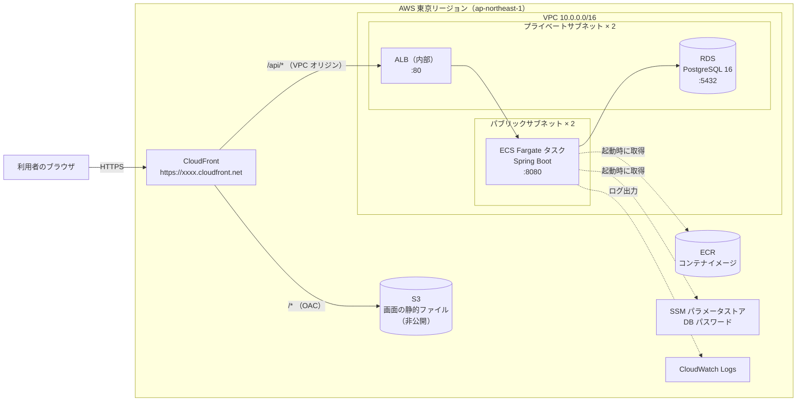
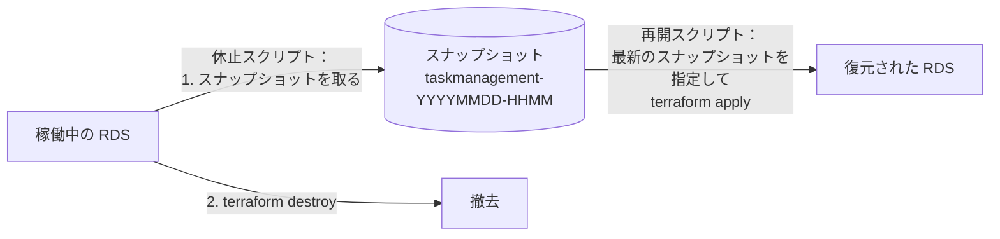

# タスク管理アプリ インフラ設計書

## 1. 文書情報

| 項目 | 内容 |
| --- | --- |
| 文書名 | タスク管理アプリ インフラ設計書 |
| 版数 | 1.3 |
| 作成日 | 2026-10-11 |
| 最終更新日 | 2026-10-17 |
| 作成者 | KeiT0773 |
| ステータス | 確定 |
| 上位文書 | [要件定義書](requirements.md)、[技術スタック](tech-stack.md) |
| 関連文書 | [データ設計書](data-design.md)、[API 設計書](api-design.md)、[フロントエンド設計書](frontend-design.md) |
| 下位文書 | [AWS デプロイ手順書](aws-deployment-guide.md) |

本書は、[要件定義書](requirements.md) 2.4 と決定事項 No.8 で「基本設計で決める」とした **サーバーの具体的な配置先**、および [技術スタック](tech-stack.md) 8. で保留していた **クラウドサービスの選定** を定義する。

配置先は **AWS（東京リージョン）** とし、すべてのリソースを **Terraform** で定義する。AWS のマネジメントコンソールでの手作業は行わず、Terraform と AWS CLI をコマンドラインから実行して構築・更新する。実際のコマンドと、AWS・Terraform の基礎知識の解説は [AWS デプロイ手順書](aws-deployment-guide.md) に記載する。

本書が扱う範囲と、扱わない範囲は次のとおり。

| 範囲 | 扱い | 定義する文書 |
| --- | --- | --- |
| AWS の構成、ネットワーク、セキュリティ、秘密情報の扱い、費用見積もり | 本書で定義する | 本書 |
| Terraform のファイル構成、リポジトリ上の配置 | 本書で定義する | 本書 |
| 認証設定・構築・デプロイ・休止・再開の具体的なコマンド | 本書では扱わない | [AWS デプロイ手順書](aws-deployment-guide.md) |
| テーブル定義、API の形式 | 本書では扱わない | [データ設計書](data-design.md)、[API 設計書](api-design.md) |

### 1.1 変更履歴

| 版数 | 日付 | 変更内容 | 変更者 |
| --- | --- | --- | --- |
| 1.0 | 2026-10-11 | 初版作成。AWS 上の構成（CloudFront + S3 / 内部 ALB + ECS Fargate / RDS PostgreSQL）、ネットワーク、セキュリティグループ、IAM、秘密情報、費用見積もり、Terraform の構成を定義 | KeiT0773 |
| 1.1 | 2026-10-11 | 使わない期間の費用をほぼゼロにするため、「休止時はすべてのリソースを `terraform destroy` で撤去し、再開時に作り直す」運用に変更。2. 方針 8、3.2、8.1（スナップショットによるデータの引き継ぎ）、9.1（シークレットの即時削除）、11. 費用見積もり、12.1 のスクリプト、決定事項 No.10〜12、14. を追加・更新。予算を $80 から $20 に変更 | KeiT0773 |
| 1.2 | 2026-10-17 | `backend/Dockerfile` の作成に合わせ、7.1 にイメージの作り方（ベースイメージ、実行ユーザー、Java のメモリ上限）を追記 | KeiT0773 |
| 1.3 | 2026-10-17 | 要件定義書 7.「費用」の追加に伴い、各リソースを無料利用枠と同じ規模に制限する 2. 方針 9 と 2.1 を追加。ECS を Fargate Spot に、DB パスワードの保管先を Secrets Manager から SSM パラメータストア（無料）に変更。RDS のストレージ自動拡張・監視の無効化を明記。11. 費用見積もり（約 $0.1 → 約 $0.07 / 時間）、10.、決定事項 No.7・12〜14 を更新 | KeiT0773 |

---

## 2. 設計方針

| No | 方針 | 理由 |
| --- | --- | --- |
| 1 | 構成は、実務で一般的な「静的配信（CloudFront + S3）＋ コンテナ（ECS Fargate）＋ マネージド DB（RDS）」とする | 本プロジェクトは学習も目的とする（要件定義書 2.1）。サーバー 1 台にすべてを載せる構成より費用はかかるが、各サービスの役割を分けて学べる |
| 2 | 画面と API を **同じドメイン（CloudFront）から配信** する。`/api/*` はバックエンドへ、それ以外は S3 へ振り分ける | フロントエンドは `/api` で始まる相対パスで API を呼んでいる（[フロントエンド設計書](frontend-design.md) 9.）。同じドメインなら、開発時の Vite プロキシと同じ形になり、コードの変更も CORS の設定も不要（[API 設計書](api-design.md) 2. 方針 1） |
| 3 | インターネットから直接到達できるのは **CloudFront だけ** にする。ALB・ECS・RDS には外部から直接届かない | 要件定義書 7.「データ保護」（DB はインターネットから直接アクセスできない）を満たし、さらに入口を 1 つに絞る |
| 4 | すべてのリソースを Terraform で定義し、コンソールでは変更しない | 構成をコードとして残し、いつでも同じ環境を作り直せるようにする（IaC。手順書 2. で解説） |
| 5 | 費用を抑えるため、冗長化（マルチ AZ の DB、複数タスク）と NAT Gateway は使わない | 利用者は 1 名で、サーバーの監視・自動復旧は対象外（要件定義書 4.2）。可用性より費用を優先する |
| 6 | 独自ドメインは取得せず、CloudFront が発行する `https://xxxx.cloudfront.net` を使う | ドメインの取得・証明書の管理が不要で、HTTPS（要件定義書 7.「通信の保護」）は CloudFront の既定の証明書で満たせる |
| 7 | 環境は本番 1 つだけとする。検証用の環境は作らない | 利用者 1 名の個人用アプリであり、動作確認はローカル環境で行う |
| 8 | **使わない期間は、すべてのリソースを `terraform destroy` で撤去する（休止）。** 使うときに `terraform apply` で作り直す（再開）。登録したカードは、休止の直前に取る DB のスナップショットで次の再開に引き継ぐ | 本構成の費用の大半（ALB・ECS・RDS）は、動いている時間に比例して課金される。止めるだけでは ALB などの費用が残るため、撤去して費用をほぼゼロにする。すべてを Terraform で定義している（方針 4）ので、いつでも同じ構成を作り直せる |
| 9 | **各リソースは、無料利用枠の対象と同じ規模を上限とする**（2.1）。無料利用枠の無いサービスは、動かせる最小に近い構成と割引の仕組み（Fargate Spot）を使い、無料のサービスで置き換えられるもの（パスワードの保管）は置き換える | [要件定義書](requirements.md) 7.「費用」、決定事項 No.13。性能より費用を優先する |

### 2.1 リソースの上限（無料利用枠と同じ規模）

本システムの AWS アカウントは、無料利用枠の期間を過ぎている（2026-10-17 に確認。有料プラン、無料プランのクレジット残高 $0）。そのため無料利用枠の対象になるリソースでも課金されるが、**規模は無料利用枠と同じ範囲に収め、これより大きな構成にはしない**。上限を超える変更が必要になったときは、要件定義書 7.「費用」の改訂から行う。

| リソース | 上限（これより大きくしない） | 無料利用枠との対応 |
| --- | --- | --- |
| RDS | `db.t4g.micro`（または `db.t3.micro`）を 1 台、シングル AZ、gp3 20 GB。ストレージの自動拡張・リードレプリカ・Performance Insights の長期保持・拡張モニタリングは使わない | 旧来の無料利用枠（micro クラス 月 750 時間、ストレージ 20 GB）と同じ規模 |
| ECS Fargate | タスク 1 つ、0.5 vCPU / 1 GB、**Fargate Spot** | Fargate には無料利用枠が無い。Spring Boot を安定して起動できる最小に近い大きさにし、Spot で約 7 割引にする（7.1） |
| ALB | 1 台 | 旧来の無料利用枠（月 750 時間）と同じ台数 |
| パブリック IPv4 アドレス | 1 個（ECS タスク） | 旧来の無料利用枠（月 750 時間）と同じ数 |
| DB パスワードの保管 | SSM パラメータストアの標準パラメータ 1 つ | 常時無料。有料の Secrets Manager は使わない（9.1） |
| CloudFront | ディストリビューション 1 つ | 常時無料の範囲（月 1 TB・1,000 万リクエスト）に収まる |
| CloudWatch Logs | ロググループ 1 つ、保持 7 日 | 常時無料の範囲（月 5 GB）に収まる |
| ECR | リポジトリ 1 つ。古いイメージは自動で消す | 保管量は数百 MB で、休止のたびに消える |
| S3 | 画面用バケット 1 つ（数 MB）、state 用バケット 1 つ（数 KB） | 保管料は月 $0.01 未満 |

---

## 3. システム構成

### 3.1 構成図



### 3.2 リクエストの流れ

| 操作 | 流れ |
| --- | --- |
| 画面を開く（`/`、`/assets/*.js` など） | ブラウザ → CloudFront → S3。2 回目以降は CloudFront のキャッシュから返る |
| API を呼ぶ（`/api/*`） | ブラウザ → CloudFront → ALB → ECS タスク（Spring Boot）→ RDS。CloudFront ではキャッシュしない |
| バックエンドを更新する | 新しいコンテナイメージを ECR に登録し、ECS のタスクを入れ替える（手順書 6.2） |
| 画面を更新する | `npm run build` の結果を S3 に上書きし、CloudFront のキャッシュを無効化する（手順書 6.3） |
| 休止する | DB のスナップショットを取ってから、`terraform destroy` ですべてのリソースを撤去する（手順書 7.2） |
| 再開する | `terraform apply` で作り直し、DB を最新のスナップショットから復元する。イメージの登録と画面の配置もやり直す（手順書 7.3） |

**再開するたびに、画面の URL（`https://xxxx.cloudfront.net` の `xxxx`）が変わる。** CloudFront を作り直すと、新しいドメイン名が割り当てられるためである。再開の手順の最後に新しい URL が表示されるので、それを開く。

### 3.3 ローカル環境との対応

| ローカル環境 | AWS | 補足 |
| --- | --- | --- |
| Vite の開発サーバー（:5173） | CloudFront + S3 | 本番では `npm run build` で作った静的ファイルを配信する |
| Vite のプロキシ（`/api` → :8080） | CloudFront のビヘイビア（`/api/*` → ALB） | 振り分けの考え方は同じ |
| `./gradlew bootRun`（:8080） | ECS Fargate のタスク（:8080） | 同じ Spring Boot を Docker イメージにして動かす |
| `compose.yaml` の PostgreSQL（:5432） | RDS for PostgreSQL（:5432） | 同じ PostgreSQL 16 系。Flyway が起動時にテーブルを作る |

---

## 4. 使用するサービス

| サービス | 役割 | 主な設定 |
| --- | --- | --- |
| CloudFront | HTTPS の入口。パスに応じて S3 と ALB に振り分ける | 既定ルートオブジェクト `index.html`、HTTP は HTTPS へリダイレクト |
| S3 | 画面の静的ファイル（`frontend/dist`）を置く | パブリックアクセスはすべて禁止。CloudFront からだけ OAC で読める |
| ALB（Application Load Balancer） | CloudFront から受けた API の要求を ECS タスクへ渡す。タスクの死活を監視する | **内部（internal）**。ヘルスチェックは `GET /api/health` |
| ECS（Fargate） | Spring Boot のコンテナを動かす。サーバー（EC2）の管理は不要 | タスク 1 つ、0.5 vCPU / 1 GB、x86_64、Fargate Spot |
| ECR | Spring Boot のコンテナイメージを保管する | タグの上書き禁止、古いイメージは自動削除 |
| RDS for PostgreSQL | データベース | PostgreSQL 16 系、`db.t4g.micro`、シングル AZ、gp3 20 GB（自動拡張なし）、外部公開なし |
| SSM パラメータストア | DB のパスワードを暗号化して保管し、ECS タスクの起動時に環境変数として渡す | 標準パラメータ（無料）、`SecureString`。9. 参照 |
| CloudWatch Logs | Spring Boot の標準出力（ログ）を保管する | 保持期間 7 日 |
| S3（state 用） | Terraform の state ファイルを保管する | Terraform の管理対象外。AWS CLI で作る（手順書 5.） |
| AWS Budgets | 月額の費用が予算を超えそうなときにメールで知らせる | 予算 $20 / 月。AWS CLI で作る（手順書 4.5）。Terraform の管理外のため、休止しても残る |

各サービスの仕組みは [AWS デプロイ手順書](aws-deployment-guide.md) 2.3 で解説する。

---

## 5. ネットワーク設計

### 5.1 VPC とサブネット

| 名前 | CIDR | AZ | 種別 | 置くもの |
| --- | --- | --- | --- | --- |
| VPC | `10.0.0.0/16` | — | — | — |
| public-a | `10.0.0.0/24` | ap-northeast-1a | パブリック | ECS タスク |
| public-c | `10.0.1.0/24` | ap-northeast-1c | パブリック | ECS タスク（予備の配置先） |
| private-a | `10.0.10.0/24` | ap-northeast-1a | プライベート | ALB、RDS |
| private-c | `10.0.11.0/24` | ap-northeast-1c | プライベート | ALB、RDS（サブネットグループの要件） |

- パブリックサブネットのルートテーブルには、インターネットゲートウェイ（IGW）への経路（`0.0.0.0/0`）を持たせる。プライベートサブネットには持たせない。
- ALB と RDS は、AWS の仕様上 **2 つ以上の AZ のサブネット** を指定する必要がある。実際に動く RDS は 1 つ（シングル AZ）である。
- CloudFront の VPC オリジンを使うには、VPC にインターネットゲートウェイが付いている必要がある（AWS の仕様）。本構成はパブリックサブネットのために IGW を付けるので、この条件も満たす。

### 5.2 NAT Gateway を使わない理由

ECS タスクは、起動時に ECR（イメージ）・SSM パラメータストア（パスワード）・CloudWatch Logs（ログ出力）と通信する必要がある。これらはインターネット側の窓口を持つサービスである。

| 方式 | 月額の目安 | 採否 |
| --- | --- | --- |
| タスクをプライベートサブネットに置き、NAT Gateway 経由で外へ出す | 約 $45 | 不採用 |
| タスクをプライベートサブネットに置き、VPC エンドポイント（ECR × 2、Logs、SSM、S3）を作る | 約 $30 | 不採用 |
| **タスクをパブリックサブネットに置き、パブリック IP を持たせて IGW 経由で外へ出す** | 約 $4（IPv4 アドレス 1 個） | **採用** |

採用案ではタスクがパブリック IP を持つが、セキュリティグループ（5.3）で **受信を ALB からの 8080 番だけに限定** するため、インターネットからタスクに直接届くことはない。

### 5.3 セキュリティグループ

セキュリティグループは「そのリソースへの通信を、どこから受け付けるか」を決める仮想ファイアウォールである。受信（インバウンド）は許可したものだけが通り、送信（アウトバウンド）は全許可とする。

| 名前 | 付けるリソース | 受信を許可する通信 |
| --- | --- | --- |
| `alb` | ALB | TCP 80 番。送信元は **CloudFront のマネージドプレフィックスリスト**（`com.amazonaws.global.cloudfront.origin-facing`）のみ |
| `ecs` | ECS タスク | TCP 8080 番。送信元は **セキュリティグループ `alb`** のみ |
| `rds` | RDS | TCP 5432 番。送信元は **セキュリティグループ `ecs`** のみ |

「送信元にセキュリティグループを指定する」と、そのグループが付いたリソースからの通信だけを許可できる。IP アドレスを書かずに済み、タスクが入れ替わって IP が変わっても設定を変えなくてよい。

---

## 6. CloudFront の設計

### 6.1 オリジンとビヘイビア

オリジンは CloudFront が要求を転送する先、ビヘイビアは「どのパスをどのオリジンへ、どう扱って送るか」の規則である。

| 優先順 | パス | オリジン | キャッシュポリシー | オリジンリクエストポリシー | 許可するメソッド |
| --- | --- | --- | --- | --- | --- |
| 1 | `/api/*` | ALB（VPC オリジン） | `Managed-CachingDisabled` | `Managed-AllViewerExceptHostHeader` | GET, HEAD, OPTIONS, PUT, POST, PATCH, DELETE |
| 既定 | `*` | S3（OAC） | `Managed-CachingOptimized` | なし | GET, HEAD |

- `/api/*` はデータを返すため、キャッシュしない。ヘッダー・クエリ文字列・本文はすべてバックエンドへ渡す（`Host` ヘッダーだけは ALB 側の名前に置き換わる）。
- 画面のファイルのうち `assets/` 配下は、Vite がファイル名にハッシュを付けるため長くキャッシュしてよい。`index.html` は名前が変わらないので、画面を更新したときにキャッシュを無効化する（手順書 6.3）。
- ビューワープロトコルポリシーは `redirect-to-https`（`http://` で来た要求を `https://` に転送する）。

### 6.2 S3 を直接公開しない（OAC）

S3 バケットはパブリックアクセスをすべて禁止し、バケットポリシーで **このディストリビューションの CloudFront からの読み取りだけ** を許可する。この仕組みを OAC（Origin Access Control）という。利用者が S3 の URL を直接開いても画面は見られない。

### 6.3 ALB を外部に出さない（VPC オリジン）

ALB は **内部（internal）** として作り、パブリック IP を持たせない。CloudFront からは **VPC オリジン** という機能で、VPC の中の ALB に直接つなぐ。

| 方式 | ALB の置き場所 | 外部からの到達 | 採否 |
| --- | --- | --- | --- |
| 公開 ALB に CloudFront からつなぎ、秘密のヘッダーで CloudFront 経由かを判定する | パブリック | ALB の DNS 名を知れば届く（ヘッダーで弾く） | 不採用 |
| **内部 ALB に VPC オリジンでつなぐ** | プライベート | 届かない | **採用** |

### 6.4 通信の暗号化

| 区間 | プロトコル | 補足 |
| --- | --- | --- |
| ブラウザ → CloudFront | HTTPS | `*.cloudfront.net` の証明書（CloudFront が自動で用意）。要件定義書 7.「通信の保護」を満たす |
| CloudFront → S3 | HTTPS | AWS 内部 |
| CloudFront → ALB | HTTP（80 番） | VPC オリジン経由で AWS のネットワーク内に閉じる。ALB に HTTPS を付けるには独自ドメインと証明書が必要になるため、本版では行わない |
| ALB → ECS、ECS → RDS | HTTP / PostgreSQL | VPC の中だけで閉じる |

要件定義書 7. が求めるのは「フロントエンドとバックエンドの間の通信を、インターネット上で盗み見られないこと」であり、インターネットを通る区間（ブラウザ → CloudFront）は HTTPS で保護される。

---

## 7. コンテナ（ECS）の設計

### 7.1 タスク定義

タスク定義は「どのイメージを、どれだけの CPU・メモリで、どんな環境変数で動かすか」をまとめた設計図である。

| 項目 | 値 | 理由 |
| --- | --- | --- |
| 起動タイプ | **Fargate Spot**（キャパシティープロバイダー `FARGATE_SPOT`） | サーバー（EC2）の OS 管理が不要。Spot は AWS の空き容量を使う方式で、通常の Fargate の約 3 割の料金で動く（2.1）。空き容量が足りなくなると、2 分前の通知のあとタスクが中断されるが、ECS サービスが自動で新しいタスクを起動する。中断から立ち直るまでの 1〜2 分は API がエラーになり、画面に接続エラーが表示される（FR-09）。個人用で常時の可用性は求めない（要件定義書 4.2）ため許容する |
| イメージ | `backend/Dockerfile` で作る。マルチステージで、実行用は `eclipse-temurin:21-jre` に jar だけを入れる | JDK・Gradle・ソースコードを含めず、イメージを小さくする |
| 実行ユーザー | `app`（UID 10001、root 以外） | コンテナが乗っ取られたときの被害を小さくする |
| Java のメモリ上限 | `-XX:MaxRAMPercentage=75`（1 GB のうち約 768 MB） | 既定（25%）のままでは、割り当てたメモリの大半が使われない |
| CPU / メモリ | 0.5 vCPU / 1 GB | Spring Boot（Java）を安定して起動できる最小に近い組み合わせ（2.1）。0.25 vCPU では起動に 1 分以上かかる見込みで、再開と Spot の中断からの立ち直りが遅くなる。0.5 GB ではメモリ不足になりやすい |
| CPU アーキテクチャ | x86_64 | Windows の PC で作るイメージがそのまま動く。ARM（Graviton）は約 2 割安いが、Windows でのイメージ作成に手間がかかる |
| コンテナのポート | 8080 | Spring Boot の既定（ローカル環境と同じ） |
| ネットワーク | `awsvpc`、パブリックサブネット、パブリック IP あり | 5.2 |
| ログ | `awslogs` ドライバーで CloudWatch Logs へ | `docker logs` に相当するものを AWS 上で見る |

### 7.2 コンテナに渡す設定

Spring Boot は、環境変数 `SPRING_DATASOURCE_URL` を `spring.datasource.url` として読む（大文字・アンダースコアの名前を、プロパティ名に自動で対応づける）。この仕組みを使い、[application.properties](../backend/src/main/resources/application.properties) のローカル用の接続先を、本番では環境変数で上書きする。

| 環境変数 | 値 | 渡し方 |
| --- | --- | --- |
| `SPRING_PROFILES_ACTIVE` | `prod` | タスク定義に直接書く |
| `SPRING_DATASOURCE_URL` | `jdbc:postgresql://<RDS のエンドポイント>:5432/taskmanagement` | Terraform が RDS の作成結果から組み立てる |
| `SPRING_DATASOURCE_USERNAME` | `taskmanagement` | タスク定義に直接書く |
| `SPRING_DATASOURCE_PASSWORD` | （秘密） | SSM パラメータストアから注入する（9.） |

`prod` プロファイル（`application-prod.properties`）では、次をローカルと変える。

| 設定 | ローカル | 本番 | 理由 |
| --- | --- | --- | --- |
| `spring.flyway.locations` | `db/migration` と `db/sample` | `db/migration` のみ | 開発用のサンプルカード（V3）を本番に入れない（[データ設計書](data-design.md) 10.4） |
| `spring.jpa.show-sql` | `true` | `false` | SQL をログに出すのは学習・調査用。本番ではログが膨らむ |

### 7.3 ヘルスチェック

ALB のターゲットグループは、既存の `GET /api/health`（DB に触れず `{"status":"ok"}` を返す）を 30 秒ごとに呼び、応答が 200 でなければタスクを異常とみなす。DB の確認を含む `/api/health/db` を使わないのは、DB が一時的に止まったときに、アプリまで再起動されるのを避けるためである。

### 7.4 イメージのタグ

コンテナイメージのタグには **Git のコミットの短縮ハッシュ**（例：`f96c3e5`）を使い、`latest` は使わない。ECR はタグの上書きを禁止する。どのコミットのコードが動いているかが、タグを見れば分かるようにするためである。

---

## 8. データベース（RDS）の設計

| 項目 | 値 | 理由 |
| --- | --- | --- |
| エンジン | PostgreSQL 16 系 | ローカル（`compose.yaml` の `postgres:16`）と同じメジャーバージョン |
| インスタンスクラス | `db.t4g.micro`（2 vCPU / 1 GB） | RDS で最小級。想定データ量（カード 100 件程度）には十分 |
| ストレージ | gp3 20 GB、暗号化あり、自動拡張なし（`max_allocated_storage` を設定しない） | gp3 の最小容量で、無料利用枠と同じ規模（2.1） |
| 配置 | シングル AZ、プライベートサブネット | 2. 方針 5 |
| 外部公開 | `publicly_accessible = false` | 要件定義書 7.「データ保護」 |
| DB 名 / ユーザー名 | `taskmanagement` / `taskmanagement` | ローカル（`compose.yaml`）と同じ名前にそろえる |
| 自動バックアップ | 保持 1 日 | 要件上バックアップ機能は対象外（要件定義書 8.）だが、RDS の既定機能を最小限で残す。休止（`destroy`）で DB と一緒に消える |
| 作成元 | 変数 `db_snapshot_identifier` が空なら新規作成、指定されていればそのスナップショットから復元（`snapshot_identifier`） | 8.1 |
| 削除時のスナップショット | Terraform では取らない（`skip_final_snapshot = true`）。休止のスクリプトが AWS CLI で取る | 8.1 |
| 削除保護 | 無効 | 休止のたびに `terraform destroy` で撤去するため |
| 監視 | Performance Insights・拡張モニタリングは使わない。CloudWatch の標準のメトリクス（無料）だけ | 2.1 |

テーブルは Terraform では作らない。新規作成のときは、ECS タスクの起動時に Flyway が `V1`・`V2` を適用する（ローカルと同じ仕組み）。スナップショットから復元したときは、Flyway の適用履歴も一緒に戻るため、未適用のファイルだけが適用される。

### 8.1 休止をまたいだデータの引き継ぎ

休止（`destroy`）では RDS も消えるため、登録したカードを残すには **スナップショット**（その時点の DB を丸ごと複製したもの）を取っておく。スナップショットは RDS 本体とは別に保管され、DB を消しても残る。



| 項目 | 決定 | 理由 |
| --- | --- | --- |
| スナップショットを取る主体 | 休止スクリプト（`infra/scripts/shutdown.sh`）が AWS CLI で取り、完成を待ってから `terraform destroy` する | Terraform の「削除時に自動で取る」機能（`final_snapshot_identifier`）は名前が固定のため、2 回目の休止で「同じ名前のスナップショットが既にある」となり失敗する。スクリプトなら日時入りの名前を付けられ、完成の確認もできる |
| 名前 | `taskmanagement-YYYYMMDD-HHMM`（休止した日時） | どれが最新かを名前で判断できる |
| 復元に使うスナップショット | 再開スクリプト（`startup.sh`）が最新のものを探し、`db_snapshot_identifier` として Terraform に渡す | 手で名前を調べて書き写す手間と、書き間違いを無くす |
| 保管する数 | 最新の 2 つ。それより古いものは休止スクリプトが消す | 直前の 1 つが壊れていた場合の予備を残しつつ、保管料を抑える |
| 初回・データを捨てたいとき | `db_snapshot_identifier` を空にして新規作成する | — |

復元した DB のマスターパスワードは、スナップショットを取ったときのものになる。再開のたびに Terraform は新しいパスワードを生成する（9.1）ため、AWS プロバイダーが復元の直後にパスワードを新しい値に変更する。これにより、SSM パラメータストアの値と DB のパスワードが一致する。この動作は、段階 3 で Terraform のコードを作るときに、実際に休止・再開して確認する。

---

## 9. 秘密情報の扱い

### 9.1 DB パスワード

| 手順 | 担当 | 内容 |
| --- | --- | --- |
| 1 | Terraform | `random_password` で 32 文字のパスワードを生成する |
| 2 | Terraform | そのパスワードで RDS を作り、同じ値を SSM パラメータストアに `SecureString`（暗号化された文字列）として保存する |
| 3 | ECS | タスクの起動時に SSM パラメータストアから読み、環境変数 `SPRING_DATASOURCE_PASSWORD` としてコンテナに渡す |

- パスワードはリポジトリにも、タスク定義の画面にも現れない。
- 休止（`destroy`）でパスワードも消え、再開のたびに新しいパスワードが生成される。
- 保管先は、有料の Secrets Manager（シークレット 1 つにつき月 $0.40）ではなく、**SSM パラメータストアの標準パラメータ（無料）** にする（2.1）。値は AWS 管理の鍵（`aws/ssm`）で暗号化される。ECS はどちらからでも同じ書き方（タスク定義の `secrets`）で値を読める。Secrets Manager の強みである自動ローテーションは、9.2 の理由で使わないため、差は無い。
- パラメータストアは削除すると即時に消える（Secrets Manager のような 30 日の削除の猶予期間が無い）ため、休止のすぐ後に同じ名前で再開できる。
- ただし **Terraform の state ファイルにはパスワードが平文で記録される**。このため state を置く S3 バケットは、パブリックアクセス禁止・暗号化・バージョニングを必須とする（手順書 5.）。

### 9.2 RDS の「パスワード自動管理」を使わない理由

RDS には、パスワードを AWS が生成して Secrets Manager に保存する機能（`manage_master_user_password`）がある。state にパスワードが残らない利点があるが、**既定で 7 日ごとにパスワードが自動で変わる**。ECS タスクは起動時にしかパスワードを読まないため、変わった後に新しい DB 接続を作ろうとすると失敗し、アプリが動かなくなる。これを避けるには、アプリ側で接続のたびにパスワードを取り直す仕組みが必要になり、学習の範囲を超える。そこで本版では、Terraform で生成した固定のパスワードを使う。

### 9.3 AWS の認証情報

Terraform と AWS CLI は、開発者の PC の `~/.aws/credentials` にある IAM ユーザーのアクセスキーで AWS を操作する（手順書 4.）。アクセスキーは Terraform のコードにも、リポジトリにも書かない。

---

## 10. IAM の設計

IAM ロールは「AWS のサービスが、他のサービスを操作するときに名乗る身分」である。人が使う IAM ユーザーとは別に作る。

| ロール | 使う主体 | 許可する操作 |
| --- | --- | --- |
| タスク実行ロール | ECS（タスクを起動する側） | ECR からイメージを取得する、CloudWatch Logs にログを書く（AWS 管理ポリシー `AmazonECSTaskExecutionRolePolicy`）。加えて、9.1 の DB パスワードのパラメータ **1 つだけ** を読む（`ssm:GetParameters`）。AWS 管理の鍵で暗号化しているため、鍵の権限（`kms:Decrypt`）の追加は不要 |
| タスクロール | コンテナの中のアプリ（Spring Boot） | 作らない。アプリは AWS のサービスを呼ばないため |

---

## 11. 費用見積もり

東京リージョンの単価をもとにした概算（2026-10 時点、税別）。無料利用枠は考慮しない。

### 11.1 稼働中

費用の大半は、リソースが存在している時間に比例する。

| サービス | 内訳 | 1 時間あたり | 30 日間つけっぱなしの場合 |
| --- | --- | --- | --- |
| ECS Fargate Spot | 0.5 vCPU + 1 GB を 1 タスク | 約 $0.009 | 約 $7 |
| RDS | `db.t4g.micro` シングル AZ + gp3 20 GB | 約 $0.029 | 約 $21 |
| ALB | 基本料金 + 最小限の処理量（LCU） | 約 $0.027 | 約 $20 |
| パブリック IPv4 | ECS タスク 1 つ | 約 $0.005 | 約 $4 |
| その他 | CloudFront、S3、ECR、SSM パラメータストア、CloudWatch Logs（大半は常時無料の範囲） | — | 約 $1 |
| **合計** | | **約 $0.07** | **約 $50〜55** |

例えば、1 日 3 時間 × 月 20 日だけ稼働させる（60 時間）なら、月 $4 前後になる。Fargate Spot の料金は需要によって変わる（目安は通常料金の約 3 割）。ALB は 1 時間未満でも 1 時間分が課金され、RDS は最低 10 分、Fargate は最低 1 分の課金がある。

### 11.2 休止中

| 残るもの | 月額の目安 | 補足 |
| --- | --- | --- |
| DB のスナップショット（最新 2 つ） | 数セント | 実際に使っている容量（カード 100 件程度なら数十〜数百 MB）に対して課金される |
| Terraform の state 用 S3 バケット | $0.01 未満 | 数 KB |
| AWS Budgets | $0 | 予算の監視は無料 |
| **合計** | **ほぼ $0** | |

### 11.3 予算アラート

予算 $20 / 月の AWS Budgets を設定し、実績が予算の 80%（$16）を超えたときと、月末の予測が予算を超えそうなときにメールで知らせる（手順書 4.5）。休止のし忘れ（つけっぱなし）に数日で気づける金額にしている。

---

## 12. Terraform の構成

### 12.1 リポジトリ上の配置

```
TaskManagement/
└── infra/
    ├── terraform/                  Terraform のコード（1 環境のみ）
    │   ├── versions.tf             Terraform と AWS プロバイダーのバージョン
    │   ├── backend.tf              state の保存先（S3）
    │   ├── variables.tf            入力値の定義
    │   ├── terraform.tfvars.example  入力値の記入例（実物の .tfvars はコミットしない）
    │   ├── network.tf              VPC、サブネット、ルートテーブル、セキュリティグループ
    │   ├── ecr.tf                  コンテナイメージの保管場所
    │   ├── rds.tf                  データベース、DB パスワード
    │   ├── alb.tf                  内部 ALB、ターゲットグループ
    │   ├── ecs.tf                  クラスター、タスク定義、サービス
    │   ├── iam.tf                  タスク実行ロール
    │   ├── logs.tf                 CloudWatch Logs
    │   ├── frontend.tf             画面用 S3、CloudFront
    │   ├── outputs.tf              URL などの出力値
    │   └── .terraform.lock.hcl     プロバイダーのバージョンの固定（コミットする）
    └── scripts/
        ├── deploy-backend.sh       イメージの作成 → ECR へ登録 → ECS を更新
        ├── deploy-frontend.sh      画面のビルド → S3 へ配置 → キャッシュの無効化
        ├── shutdown.sh             休止：スナップショット → 古いスナップショットの削除 → terraform destroy
        └── startup.sh              再開：最新スナップショットの指定 → ECR → イメージ登録 → terraform apply → 画面の配置
```

- 1 環境のみのため、モジュールには分けず、役割ごとにファイルを分ける。
- `.terraform/`（ダウンロードしたプロバイダー）、`*.tfstate`、実物の `*.tfvars` は Git に含めない。

### 12.2 バージョンと共通設定

| 項目 | 値 | 理由 |
| --- | --- | --- |
| Terraform | 1.10 以上 | S3 だけで state のロックができる機能（`use_lockfile`）が 1.10 で入ったため |
| AWS プロバイダー | 実装時点の最新メジャー版に固定（例：`~> 6.0`） | メジャー版の更新では書き方が変わることがあるため、意図せず上がらないようにする |
| リージョン | `ap-northeast-1`（東京） | 利用者が日本にいる。既存の AWS CLI の設定とも同じ |
| 共通タグ | `Project = taskmanagement`、`ManagedBy = terraform` | 費用の内訳を絞り込んだり、Terraform 管理外のリソースと区別したりするため |

### 12.3 state の保存先

| 項目 | 値 |
| --- | --- |
| バケット名 | `taskmanagement-tfstate-<AWS アカウント ID>`（S3 のバケット名は世界で一意にする必要があるため、アカウント ID を付ける） |
| キー | `prod/terraform.tfstate` |
| ロック | `use_lockfile = true`（S3 上にロック用のファイルを置く。DynamoDB は使わない） |
| 作り方 | AWS CLI で作る。state の保存先自体を Terraform で管理すると「state を置く場所の state をどこに置くか」という循環になるため |

---

## 13. 決定事項

| No | 決定内容 | 関連 | 決定日 |
| --- | --- | --- | --- |
| 1 | 配置先は AWS 東京リージョンとし、CloudFront + S3（画面）、内部 ALB + ECS Fargate（API）、RDS for PostgreSQL（DB）で構成する | 2.、3. | 2026-10-11 |
| 2 | 構築・更新は Terraform と AWS CLI で行い、マネジメントコンソールでは変更しない | 2. | 2026-10-11 |
| 3 | 画面と API を CloudFront の同じドメインから配信し、`/api/*` だけをバックエンドへ振り分ける | 6.1 | 2026-10-11 |
| 4 | ALB は内部とし、CloudFront の VPC オリジンでつなぐ | 6.3 | 2026-10-11 |
| 5 | NAT Gateway は使わず、ECS タスクをパブリックサブネットに置いてセキュリティグループで受信を制限する | 5.2、5.3 | 2026-10-11 |
| 6 | 独自ドメインは使わず、CloudFront の既定のドメインと証明書で HTTPS にする | 6.4 | 2026-10-11 |
| 7 | DB パスワードは Terraform で生成して保存し、自動ローテーションは行わない（保存先は No.12） | 9. | 2026-10-11 |
| 8 | 本番では Flyway のロケーションから開発用サンプルデータ（V3）を外す | 7.2 | 2026-10-11 |
| 9 | Terraform の認証には、既存の IAM ユーザーのアクセスキー（`default` プロファイル）を使う | 9.3 | 2026-10-11 |
| 10 | 使わない期間は `terraform destroy` ですべてのリソースを撤去し（休止）、使うときに作り直す（再開）。ECS のタスク数を 0 にする・RDS を停止するといった「止める」運用は行わない | 2. 方針 8、11. | 2026-10-11 |
| 11 | 休止をまたいだデータは、休止スクリプトが取る RDS のスナップショットで引き継ぐ。最新の 2 つを残す | 8.1 | 2026-10-11 |
| 12 | DB パスワードは SSM パラメータストアの標準パラメータ（無料）に保存する。削除の猶予期間が無いため、休止の直後でも再開できる（2026-10-17 に Secrets Manager から変更） | 9.1 | 2026-10-17 |
| 13 | 各リソースは無料利用枠の対象と同じ規模を上限とし、それより大きな構成にしない | 2. 方針 9、2.1 | 2026-10-17 |
| 14 | ECS のタスクは Fargate Spot で動かす。中断されたときは ECS サービスが自動で起動し直し、その間の 1〜2 分の停止は許容する | 7.1 | 2026-10-17 |

---

## 14. 対象外・保留事項

| 事項 | 扱い | 再検討する時期 |
| --- | --- | --- |
| 認証・ログイン機能 | 設けない（[要件定義書](requirements.md) 決定事項 No.9）。URL を知る第三者は誰でも閲覧・変更できるため、CloudFront の URL は本人以外に教えない | アクセス制限を実装する場合（要件定義書 9.） |
| 独自ドメイン、ALB の HTTPS 化 | 行わない（6.4） | 独自ドメインを取得する場合 |
| 再開後も変わらない URL | 提供しない。再開のたびに CloudFront の URL が変わる（3.2） | 毎回同じ URL で開きたくなった場合（独自ドメインを取得するか、CloudFront と S3 だけを休止の対象から外す） |
| CI/CD（GitHub Actions からの自動デプロイ） | 行わない。デプロイは手元の PC からスクリプトで行う | デプロイの頻度が増えた場合 |
| 監視・アラート・自動復旧 | ALB のヘルスチェックによるタスクの入れ替え以外は行わない（要件定義書 4.2） | 運用機能を追加する場合 |
| DB のバックアップ・書き出し | RDS の自動バックアップ（保持 1 日）のみ（要件定義書 8.） | データの保全が必要になった場合 |
| IAM Identity Center（一時的な認証情報）への移行 | 本版はアクセスキー方式（手順書 4.6 で紹介のみ） | アクセスキーの管理を見直す場合 |
